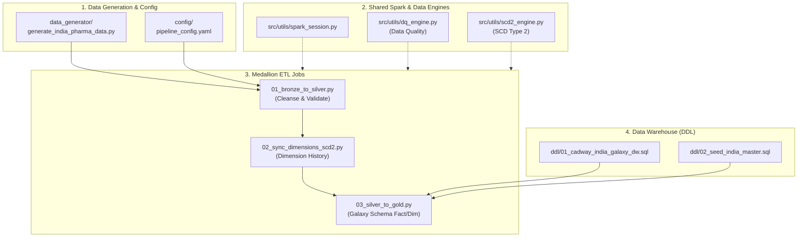

# 🧬 Cadway Life Sciences India — Enterprise Pharma Data Lakehouse

[](https://github.com)


An end-to-end, production-grade **Data Engineering Lakehouse & Dimensional Warehouse** built for **Cadway Life Sciences** (Commercial Marketing & Sales) and its parent company **Zedlay Pharma** (Clinical Trials & Schedule M Manufacturing) operating across **India**.

This pipeline ingests multi-million-row heterogeneous datasets, enforces strict data quality with an auditable **Quarantine Dead-Letter pattern**, protects patient privacy via **SHA-256 ABHA tokenization**, maintains full historical accuracy using **Hash-Based SCD Type 2 Dimensions**, and serves cross-domain **Indian Fiscal Year (FY) KPIs** in INR (₹).

---

## 🏗️ System Architecture

```text
┌────────────────────────────────────────────────────────────────────────────────────────┐
│                           1. RAW INGESTION (INDIA PHARMA SOURCES)                      │
│  • Clinical Trials (CTRI India Observations, Biomarkers, ABHA IDs)                     │
│  • Pharmaceutical Manufacturing (Baddi, Hyderabad, Ankleshwar Batch & QC Logs)         │
│  • Commercial Sales & Marketing (NMC Doctor Prescriptions, INR Sales, 12% GST)         │
└───────────────────────────────────────────┬────────────────────────────────────────────┘
                                            │
                                            ▼
┌────────────────────────────────────────────────────────────────────────────────────────┐
│                     2. AWS S3 MEDALLION LAKEHOUSE (STORAGE LAYER)                      │
│  ┌──────────────────────┐    ┌──────────────────────────┐    ┌──────────────────────┐  │
│  │   01-BRONZE-RAW      │    │   02-SILVER-CURATED      │    │  99-QUARANTINE-DLQ   │  │
│  │  • Immutable CSV     │───►│  • Snappy Parquet        │    │  • Malformed Rows    │  │
│  │  • PERMISSIVE Read   │    │  • Partitioned by Date   │    │  • Outlier Records   │  │
│  └──────────────────────┘    │  • SHA-256 ABHA Masking  │    │  • Audit Timestamps  │  │
│                              └────────────┬─────────────┘    └──────────────────────┘  │
└───────────────────────────────────────────┼────────────────────────────────────────────┘
                                            │
                                            ▼
┌────────────────────────────────────────────────────────────────────────────────────────┐
│                 3. DISTRIBUTED PYSPARK ENGINE (AQE + SKEW-JOIN TUNED)                  │
│  • Job 01: Vectorized Cleaning, Date Standardization (DD-MM-YYYY), Dedup & Quarantine  │
│  • Job 02: Chronological Hash-Based SCD Type 2 Dimension Merge Engine                  │
│  • Job 03: Point-In-Time Surrogate Key Resolution & Executive KPI Aggregation          │
└───────────────────────────────────────────┬────────────────────────────────────────────┘
                                            │
                                            ▼
┌────────────────────────────────────────────────────────────────────────────────────────┐
│                  4. MYSQL 8.0 SERVING WAREHOUSE & OBSERVABILITY                        │
│  • Galaxy Schema: 3 Fact Tables + 6 Dimensions (4 SCD Type 2 + 2 Static Indian Master) │
│  • mart_cadway_india_kpis: Pre-aggregated Indian FY, Zone & Brand Metrics (₹ Lakhs)    │
│  • etl_pipeline_audit: Row-level SLA tracking (Read vs. Valid vs. Quarantined)         │
└────────────────────────────────────────────────────────────────────────────────────────┘
```

---

## 📊 Galaxy Star Schema Data Model

The analytical warehouse implements a **Constellation (Galaxy) Schema** connecting shared enterprise dimensions across three distinct business fact tables, enabling end-to-end traceability from drug batch yield to commercial net revenue.

```text
                    ┌──────────────────────┐
                    │   dim_product_scd2   │ (CDSCO Code, Brand, NPPA MRP ₹)
                    └──────────┬───────────┘
                               │
        ┌──────────────────────┼──────────────────────┐
        ▼                      ▼                      ▼
┌───────────────┐      ┌───────────────┐      ┌───────────────┐
│fact_clinical  │      │fact_mfg_      │      │fact_commercial│
│_observations  │      │batches        │      │_sales_india   │
└───────┬───────┘      └───────┬───────┘      └───────┬───────┘
        │                      │                      │
        ▼                      ▼                      ▼
┌───────────────┐      ┌───────────────┐      ┌───────────────┐
│dim_patient_   │      │dim_facility_  │      │dim_doctor_    │
│scd2 (ABHA ID) │      │scd2 (WHO-GMP) │      │scd2 (NMC Reg) │
└───────┬───────┘      └───────┬───────┘      └───────┬───────┘
        │                      │                      │
        └──────────────────────┼──────────────────────┘
                               ▼
              ┌─────────────────────────────────┐
              │ dim_geography_india & dim_date  │ (36 States/UTs, Indian FY)
              └─────────────────────────────────┘
```

### Data Dictionary

| Table Name | Type | Grain / Business Key | SCD Type | Key Attributes & Metrics |
| :--- | :--- | :--- | :--- | :--- |
| `dim_product_scd2` | Dimension | `cdsco_drug_code` | Type 2 | `molecule_name`, `brand_name`, `therapeutic_area`, `schedule_category`, `mrp_inr` |
| `dim_patient_scd2` | Dimension | `abha_token_id` (SHA-256) | Type 2 | `age_group`, `gender`, `comorbidity_risk` (Low/Moderate/High) |
| `dim_facility_scd2` | Dimension | `facility_code` | Type 2 | `plant_name` (Baddi/Hyderabad/Ankleshwar), `who_gmp_status` |
| `dim_doctor_scd2` | Dimension | `nmc_reg_number` | Type 2 | `specialty`, `prescriber_tier` (Silver/Gold/Platinum) |
| `dim_geography_india` | Dimension | `state_code` | Static | All 28 Indian States & 8 UTs mapped to `zone` & `city_tier` |
| `dim_date` | Dimension | `date_sk` (YYYYMMDD) | Static | `indian_fy` (FY2026-27), `indian_fy_quarter` (Q1 Apr–Jun) |
| `fact_clinical_observations` | Fact | `obs_id` | Append/Upsert | `ctri_trial_id`, `trial_phase`, `biomarker_level`, `adverse_event_flag` |
| `fact_mfg_batches` | Fact | `batch_lot_id` | Append/Upsert | `input_kg`, `output_kg`, `yield_pct`, `qc_passed`, `mfg_cost_inr` |
| `fact_commercial_sales_india` | Fact | `invoice_id` | Append/Upsert | `promo_channel`, `strips_sold`, `gross_sales_inr`, `gst_amount_inr` (12%), `net_revenue_inr` |
| `mart_cadway_india_kpis` | Aggregate Mart | `(kpi_month, zone, brand)` | Overwrite | `active_trial_patients`, `adverse_event_rate_pct`, `avg_batch_yield_pct`, `net_revenue_lakhs_inr`, `marketing_roi` |
| `etl_pipeline_audit` | Observability | `run_id` | Append | `job_name`, `domain`, `records_read`, `records_valid`, `records_quarantined` |

---

## 🚀 Quickstart (One-Command Local Execution)

This repository is fully containerized using Docker Compose, automatically provisioning MySQL 8.0, seeding all 36 Indian States/UTs and Indian Fiscal Year dates, generating dirty/clean synthetic Indian pharma datasets, running `pytest` unit tests, and executing the entire PySpark Medallion pipeline.

### Prerequisites

* **Docker** & **Docker Compose** installed

### Run the Complete Pipeline

```bash
git clone https://github.com<your-username>/cadway-india-pharma-lakehouse.git
cd cadway-india-pharma-lakehouse

# Build containers, run unit tests, execute ETL jobs, and populate MySQL DW
docker compose up --build
```

### Verify SCD Type 2 Versioning & KPIs in MySQL

Once the `cadway-spark-etl` container finishes, inspect the SCD Type 2 history chain and executive KPIs:

```bash
docker exec -it cadway-mysql-dw mysql -u root -pCadwayRootPassword123! cadway_india_dw -e "
-- 1. Verify SCD Type 2 History Chain for Doctor NMC-MH-99999 (Silver -> Platinum promotion)
SELECT nmc_reg_number, prescriber_tier, effective_start_date, effective_end_date, is_current
FROM dim_doctor_scd2 
WHERE nmc_reg_number = 'NMC-MH-99999';

-- 2. Verify Pipeline Observability & Quarantine Counts
SELECT domain, records_read, records_valid, records_quarantined, status 
FROM etl_pipeline_audit;

-- 3. Query Cross-Domain Indian Executive KPIs
SELECT indian_fy, kpi_month, zone, brand_name, avg_batch_yield_pct, net_revenue_lakhs_inr, marketing_roi
FROM mart_cadway_india_kpis 
LIMIT 10;"
```

---

## 🧠 Engineering & System Design Highlights (MAANG Talking Points)

1. **Zero-Drop Quarantine Architecture (`PERMISSIVE` Mode):**
   Instead of failing pipelines or silently dropping bad records, PySpark reads raw CSVs with explicit schemas in `PERMISSIVE` mode. Domain validation rules (mass balance checks `output_kg <= input_kg`, physiological biomarker bounds, and negative sales checks) route corrupt rows to an auditable `99-quarantine-errors/` S3 prefix with timestamps.

2. **Chronological Hash-Based SCD Type 2 Engine:**
   Rather than slow column-by-column comparisons, `SCDType2Processor` computes deterministic SHA-256 row checksums (`row_hash`) across tracked mutable attributes. It processes incoming slices chronologically, expiring changed records (`is_current = 0`, `effective_end_date = change_date - 1`) and inserting new active versions.

3. **Point-In-Time Fact Resolution:**
Fact jobs join dimensions using temporal range predicates (event_date BETWEEN effective_start_date AND effective_end_date), ensuring historical sales and clinical observations remain attributed to the exact doctor tier, drug MRP, or plant WHO-GMP status active on the transaction date.
4. Distributed Spark Performance Optimizations:
	• Eliminated Python UDFs: All string cleaning, Indian date parsing (DD-MM-YYYY, DD/MM/YYYY), and dictionary mappings use native Catalyst vectorized expressions (F.create_map, F.coalesce, F.regexp_replace).
	• Shuffle Mitigation: Small master dimensions (dim_product_scd2, dim_geography_india, dim_facility_scd2) are explicitly broadcasted (F.broadcast) to eliminate expensive sort-merge shuffles across multi-million-row fact joins.
	• Adaptive Query Execution (AQE): Enabled spark.sql.adaptive.enabled and skewJoin.enabled to dynamically coalesce small partitions and handle data skew across high-volume Indian pharma hubs (e.g., Maharashtra, Telangana, Gujarat).
5. Automated CI/CD Quality Gates:
Every push and pull request triggers .github/workflows/ci_cd_pipeline.yml, enforcing PEP8 standards via flake8 and validating data cleaning and SCD Type 2 expiration logic via pytest.

## 🏗️ Project Architecture

### 1. Data Lakehouse & ETL Pipeline


### 2. CI/CD & Containerized Execution

